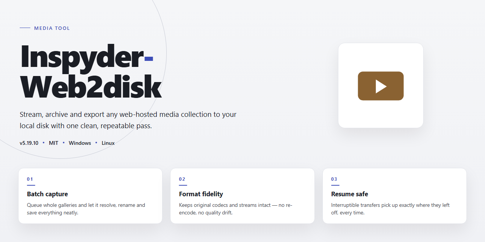

# 🎬 Seamless Site-to-Disk Capture Workflow — Video Tool

### 🖥️ PowerShell Setup

   

---

Inspyder Web2Disk turns the sprawling map of a website into a tidy, browsable folder tree you can explore without a connection. Point it at a site, set your depth and filters, and watch it pull pages, images, and protected content into a local copy that mirrors the original. Scheduling keeps recurring captures running quietly in the background while you focus on other work. It's a download manager built for people who think in structure and workflow—grab the whole picture, then shape it to fit.

## ✅ Before You Start

- **OS:** Windows 10 / 11
- **Shell:** PowerShell 5.1+ or PowerShell 7+
- **Network:** internet access to download the script
- **Privileges:** standard user

## Features

**See the whole site before you save a single byte.** Inspyder Web2Disk paints your target website as a living map — every page, asset, and hidden branch laid out in front of you, so you always know exactly what you're about to pull down. Depth is a dial, not a guess: spiral out as far as you need or stop at the front door, and watch the preview shift with every turn.

**Build a download that looks the way you think.** Depth limits, URL exclusions, image handling, and password-protected areas all live in one clear control panel — arrange the rules once, and Web2Disk follows them to the letter. Excluded paths stay excluded, protected corners get the credentials they need, and nothing sneaks in that you didn't ask for.

**Let the clock do the heavy lifting.** Point Web2Disk at a site and hand it a schedule — overnight, off-peak, whenever the bandwidth is yours. It runs quietly in the background, capturing full sites while you sleep and landing everything neatly organized on disk.

**Refresh without starting over.** Incremental updates revisit a saved site and pull only what's changed, so your offline copy stays current without re-downloading the world. Multi-threaded transfers keep every run brisk, and the progress view tells you at a glance what's done, what's moving, and what's next.

**Keep it tidy, keep it yours.** Projects hold their own settings, so a research archive, a client reference site, and a weekend reading stash never bleed into each other. Every capture lands in a clean, browsable folder structure that works offline the moment it finishes — open it and the site simply is there.

**Made for the way you actually work.** A friendly interface for the first run, deep controls for the hundredth. Comprehensive help documentation stands by when you want to go further, and the whole experience is built to keep saving, scheduling, and organizing without getting in your way.

## How It Works

Think of Inspyder Web2Disk as a digital archivist that works while you watch. You point it at a starting address, define how far it should wander, and it quietly maps and mirrors what it finds — page by page, image by image, link by link — until a complete offline copy is sitting on your drive.

The process unfolds in a few visual, tangible stages:

**1. Seed the Crawl.** You hand the tool a starting point — a homepage, a documentation hub, a blog archive. This becomes the root of everything that follows.

**2. Draw the Boundary.** Depth controls act like a perimeter fence: level one stays on the front page, deeper levels follow links outward. You decide how wide the net casts, and the tool respects it precisely.

**3. Choose What Travels.** Toggle asset types on or off — keep the images, skip the media, retain the stylesheets. What gets saved is entirely your call, so your offline copy feels complete without carrying dead weight.

**4. Cross the Gate.** For sites behind a login, credentials are supplied up front. The crawler authenticates once, then moves through protected pages as if it belonged there.

**5. Watch the Map Fill In.** A live progress view shows pages discovered, files retrieved, and the growing structure of your local mirror — a visual tree of the site taking shape in real time.

**6. Schedule and Forget.** Set a time, set a recurrence, and walk away. The tool wakes on your schedule, refreshes what's changed, and leaves the rest untouched — an incremental update rather than a full rebuild.

**7. Land on Disk.** When the run finishes, you have a browsable, self-contained copy. Links resolve locally, images load instantly, and the whole thing works with the network cable unplugged.

Behind the scenes, multiple download threads keep the pipeline full, so large sites don't crawl at a crawl. Exclusion rules let you prune entire branches before they're fetched, keeping archives lean. And because every project is saved as a reusable profile, re-running a capture later is a single click — the boundaries, filters, and credentials are all still there, waiting.

## Workflow

Inspyder Web2Disk turns a sprawling website into a tidy folder on your drive. The workflow is built around a single idea: you point at a site, you draw its boundaries, and the tool pulls it down piece by piece — images, pages, styles, and all.

**1. Drop in the address.** Paste the starting address of the site you want to capture. This becomes the seed — the anchor point every other decision builds from. Think of it as choosing which branch of the tree you want to bring home.

**2. Draw the depth boundary.** Decide how many links deep the download should travel. Depth 1 grabs just the starting page; deeper levels follow links outward, page by page. The visual preview of the crawl map makes it easy to see how far the net will spread before you cast it.

**3. Set the filters.** Tell the tool what to skip. Exclude specific paths, file types, or entire subdomains so the archive stays clean and only the content you actually want lands on disk. Filters are the scissors; depth is the reach.

**4. Add credentials where needed.** For sites behind a login wall, supply the access details once and the tool carries them through the crawl, so protected pages download alongside public ones without stopping to prompt.

**5. Choose the schedule.** Run the download immediately, or queue it for a later window. Recurring schedules keep an archive current by revisiting the site on your terms — nightly, weekly, whenever the content shifts.

**6. Watch the crawl unfold.** The progress view shows pages discovered, files fetched, and any links that failed, live as they happen. Pause, resume, or adjust mid-flight without losing what's already saved.

**7. Land the archive.** Finished downloads land in a structured folder mirroring the site's own layout, ready to open offline in any browser. Incremental runs later top up only what changed — no re-downloading the parts you already have.

The whole loop — seed, bound, filter, fetch, land — stays visible at every step, so you always know exactly what's coming down and where it's going.

## FAQ

**How deep can I actually go before a site turns into a rabbit hole?**

Depth is your zoom lens. A depth of one keeps you on the landing page and its direct links — perfect for grabbing a single article and its assets. Crank it higher and you're sweeping whole sections, galleries, or documentation trees. Watch the file count climb as you widen the net; the sweet spot is usually the shallowest depth that still catches everything you need.

**Can I point it at a site that hides behind a login?**

Yes. Password-protected sites are handled through the credential options, so the crawler can authenticate before it starts pulling pages. Think of it as handing the tool a key before it walks through the door — the download then proceeds as if the site were wide open.

**What happens when a site updates after I've already saved it?**

That's where incremental updates shine. Rather than re-downloading the entire site, the tool revisits what's changed and refreshes only the stale pieces. Your offline mirror stays current without ballooning into duplicated copies of everything.

**How do I keep a big download from hogging my connection all day?**

Schedule it. Set the job to run overnight or during off-hours, and the download manager quietly works the queue while you're away. Come morning, the site is sitting on your disk, fully mirrored, waiting.

**My download stalled partway — do I start over?**

No need. Rerun the same project and the tool picks up where it left off, skipping files it already has. It's the difference between re-painting a whole wall versus touching up the one spot you missed.

**What's the trick to getting clean, usable results?**

Start small: run a shallow test pass on a single section, eyeball the output, then widen the scope once you're happy with the shape of it. Exclude the URL patterns you don't want early — trimming noise before a big crawl beats cleaning it up afterward. And check the depth setting twice; it's the single knob that most changes what lands on your disk.

**Is there a cap on how many projects I can keep?**

No. Build as many download projects as your workflow needs — one per site, one per research topic, one per client — and manage them side by side from the same interface.

**Where do I turn if something behaves unexpectedly?**

The bundled help documentation covers the common snags and walks through the settings in plain language. Start there before assuming the worst — most "problems" turn out to be a depth setting or an exclusion rule doing exactly what it was told.

## License

Think of the license as the handshake before the harvest: **Inspyder Web2Disk** grants you the full toolkit — every scheduler toggle, every depth slider, every password-protected crawl — free of charge, no feature gates, no nag screens, no locked doors behind the interface. You get the complete workflow as it was designed to be used.

Because the tool exists to move the web onto your disk, the license follows the same logic: what you capture is yours to keep, organize, and revisit offline. Your download projects, queue configurations, and saved site archives belong to you — the license places no claim on the content you choose to preserve or the folder structure you build around it.

The license travels with the software, not around it. You're welcome to use Inspyder Web2Disk across the projects and machines that make up your own workflow; redistributing, reselling, or repackaging the tool itself as a separate product is where the line sits. Keep the installer whole, keep the credits intact, and the agreement stays simple.

Updates arrive under the same terms as the original download — when a new build sharpens the scheduler or widens format support, it lands under the same free umbrella, no renegotiation required. The license doesn't expire, doesn't meter your usage, and doesn't ask you to re-register when your project list grows.

In short: download freely, schedule boldly, archive deeply — and let the legal fine print stay as lightweight as the workflow it protects.